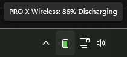
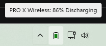
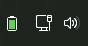
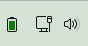
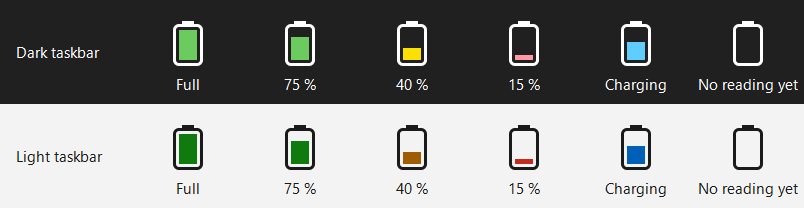
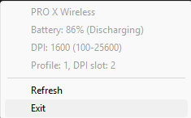

# SuperLightBattery

A tiny Windows tray indicator for your Logitech mouse battery. No G HUB, no service, no telemetry.

<p>
  
  &nbsp;&nbsp;
  
</p>

- Shows the battery of a Logitech PRO X Superlight (and similar HID++ devices) in the system tray.
- Updates by itself: the mouse reports battery changes, charging and waking up, so there is no polling.
- Follows the light or dark taskbar automatically.
- Handles several devices at once.
- Uses about 1–2 MB of memory, one thread and no CPU while idle. Small native binaries, no background framework.

Tested on Windows 11; requires Windows 10 version 1703 or later.

## Compatibility

Tested with the original Logitech PRO X Superlight, both through its LIGHTSPEED receiver and on its USB cable.

Other Logitech LIGHTSPEED / HID++ devices that report a battery percentage (HID++ features `0x1004` Unified Battery or `0x1000` Battery Status), including the PRO X Superlight 2, may or may not work. Older devices that only report a voltage are not supported. Reports are welcome; see [Troubleshooting](#troubleshooting).

## Install

1. Download the latest release zip from the [Releases](https://github.com/Lken-cmd/SuperLightBattery/releases) page.
2. Unzip it anywhere. Keep `SuperLightBattery.exe`, `SuperLightBatteryLauncher.exe`, and `SuperLightBatteryInstaller.exe` next to each other.
3. Run `SuperLightBatteryInstaller.exe`.
4. Click **Install**. The tray icon appears, and the app starts automatically at every logon from then on.

No admin rights are required. Files go to `%LOCALAPPDATA%\SuperLightBattery` and a `SuperLightBattery` shortcut is added to the current user's Startup folder.

Windows 11 puts new tray icons in the hidden area behind the **^** arrow. To keep the battery always visible, drag it onto the taskbar, or switch it on under **Settings → Personalization → Taskbar → Other system tray icons**.

<p>
  
  &nbsp;&nbsp;
  
</p>

## Use

The tray icon is a standing battery whose fill shows the level; hover over it for the exact percentage. It follows the taskbar theme (light or dark) automatically.



- The fill is **green** above 50 %, **amber** 21–50 %, **red** at 20 % and below.
- A **blue** fill means the device is charging.
- An empty battery means there is no reading yet, for example when the mouse has been asleep since the tray started.
- With several devices, the icon shows the lowest battery among the connected ones, and the tooltip lists every device. A device that is asleep or switched off keeps its last value, marked "(offline)".

Right-click the icon for the details of each device:



| Action on the icon | What happens |
| --- | --- |
| Hover | Tooltip with each device's battery level and state. |
| Right-click | Reads fresh values and opens the menu with battery, DPI, and onboard profile for each device. |
| Keyboard | Press **Win+B**, use the arrow keys to reach the icon, then **Shift+F10** opens the same menu. |
| Refresh menu item | Detects devices again and re-reads everything. |
| Exit menu item | Closes the tray app. The startup entry stays in place, so it will run again at next logon unless you uninstall. |

SuperLightBattery only reads; it never changes device settings.

## How light is it?

The tray keeps the receiver's HID++ channel open and sleeps until a device reports something by itself: a battery change, charging starting or stopping, the mouse waking up or going to sleep, or a device being plugged in. Between those moments it does nothing at all. There are no timers and no polling.

On a Windows 11 test machine it shows about 1–2 MB in Task Manager's Memory column, runs on a single thread, and used 0.05 seconds of CPU time in its first ten minutes. It loads only core Windows DLLs.

## Troubleshooting

- **No icon in the tray:** look behind the **^** arrow, and see the tip under [Install](#install) to keep it visible.
- **The battery stays empty:** there is no reading yet. Move the mouse to wake it, or right-click the icon and choose **Refresh**.
- **"(offline)" in the tooltip:** the device is asleep, switched off, or out of range. It shows the last value it reported and updates as soon as the device reconnects.
- **Your device isn't found:** run `SuperLightBattery.exe --probe` and open an issue with its output. It shows product IDs and the battery feature, but no serial numbers or USB instance IDs.

## Uninstall

Run the installer again and click **Uninstall**, or:

```powershell
SuperLightBatteryInstaller.exe --uninstall
```

This deletes the files, removes the startup shortcut and stops the running tray.

## CLI

For scripting and one-off checks, `SuperLightBattery.exe` has a small CLI:

```powershell
SuperLightBattery.exe --list-devices   # list Logitech HID++ collections
SuperLightBattery.exe --probe          # show which devices answer and their battery feature
SuperLightBattery.exe --once           # print a JSON snapshot of every device and exit
```

`--once` example output:

```json
{
  "devices": [
    {
      "battery": {
        "percent": 46,
        "state": "Discharging",
        "charging": false,
        "source": "Unified battery 0x1004"
      },
      "device": {
        "name": "PRO X Wireless",
        "hid_product": "USB Receiver",
        "transport": "receiver",
        "vid": "VID_046D",
        "pid": "PID_C547",
        "hidpp_device_index": "0x01"
      },
      "dpi": {
        "current": 1600,
        "min": 100,
        "max": 25600
      },
      "profile": {
        "index": 1,
        "dpi_slot": 2
      }
    }
  ]
}
```

Notes:

- `devices` lists every device that answered. It is empty, and the exit code is 1, when none did.
- `battery.percent` is firmware-reported.
- `battery.source` names the HID++ feature that supplied the value.
- `device.name` is the firmware-reported name; `device.hid_product` is the generic Windows HID product string.
- `device.transport` is `wired` for a device on its cable and `receiver` for one behind a receiver.
- Unsupported sections come back as `null`.
- The CLI can run while the tray is running.

## Build from source

You need the MSVC C++ x64 build tools (Visual Studio 2019 or later) and PowerShell.

```powershell
.\build.ps1
```

The build writes:

```text
out\SuperLightBattery.exe
out\SuperLightBatteryLauncher.exe
out\SuperLightBatteryInstaller.exe
```

The app and installer are statically linked against the MSVC CRT (`/MT`); the small startup launcher is CRT-free. The binaries depend only on core Windows DLLs (`kernel32`, `user32`, `gdi32`, `shell32`, `cfgmgr32`, `hid`, `advapi32`, `comctl32`, `ole32`). The icon is regenerated from `assets/generate-icon.ps1` if missing.

## Releases

Tagged releases (`v*`) trigger a GitHub Actions build on `windows-latest` that zips the binaries plus the README and LICENSE and publishes a GitHub Release.

```powershell
git tag -a vX.Y.Z -m ""
git push origin vX.Y.Z
```

## What it doesn't do

- Replace Logitech G HUB. It only reads battery, DPI, and profile state.
- Change DPI, lighting, button mappings, profiles, firmware, or pairing.
- Talk to the network. No telemetry, no auto-update, no analytics.

## Disclaimer

SuperLightBattery is an independent open source project and is not affiliated with, endorsed by, or sponsored by Logitech. "Logitech", "LIGHTSPEED", and "PRO X Superlight" are trademarks of their respective owner and are used here only to describe device compatibility.

## License

SuperLightBattery is licensed under the MIT License. See [LICENSE](LICENSE).
